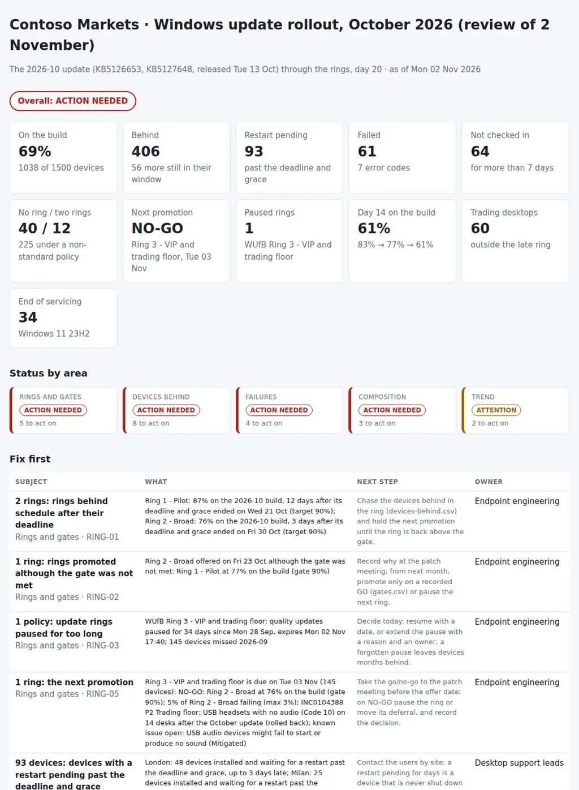

# Windows Update Ring Tracker

The monthly Patch Tuesday rollout for Windows endpoints, ring by ring: is each update ring on schedule against its deferral and deadline, is it safe to promote the next one, which devices are behind and why, does the pilot look like the rest of the fleet, and is the rollout getting faster or slower month after month? From the Intune managed devices, the update ring policies (and the Configuration Manager deployments of co-managed devices), the Windows Update for Business reports, the monthly builds and known issues of Windows release health, and the incidents tagged to an update, it puts together:

- **Rings and gates:** every ring against its offer date, deadline and grace, the gate between rings (the previous ring's share on the build, its failure rate, the days since it was offered, open P1/P2 incidents on the update, known issues that block the next ring), rings promoted although the gate was not met, the go/no-go for the next promotion, rings paused and forgotten, and ring policies that drift from the standard.
- **Devices behind:** not on the month's build after their own deadline and grace, with a restart pending, not checked in (by site, so a whole office going quiet stands out), in no ring or in two, on a Windows 11 version close to its end of servicing, or under a feature update safeguard hold.
- **Failures:** error codes by model, so one laptop model failing with one code points to its firmware or driver baseline; devices that fail month after month; and the incidents tagged to the update.
- **Composition:** trading desktops outside the late ring, a pilot that is mostly IT staff or misses the broad ring's models and sites, and rings off their target size.
- **Trend:** the share of devices on each month's update by day 7, 14 and 21 after Patch Tuesday for the last three months, the median days to install by ring, and the devices behind every month.

Five CSVs, one JSON with the ring standard and the gates, and one Python command give each area a status (**on track**, **attention** or **action needed**), an overall verdict, a timeline of the month with the gates between rings, and the pack for the monthly patch meeting or the CAB: **where each ring is, whether the next one can go, and who has to chase which devices.**

Python 3.10+, standard library only. It runs with fictional demo data out of the box. A read-only PowerShell exporter for Microsoft Graph, Windows Update for Business reports (Log Analytics) and Configuration Manager is included.



## Why

The update ring report says how many devices installed the update. It does not say whether the rollout is under control. In a typical month:

- the broad ring is offered the update on its date, ten days after Patch Tuesday, while the pilot is still at 77%, because the deferral is a timer, not a decision;
- the late ring for the trading floor was paused after September's USB audio issue and forgotten; five weeks later it is still on August's build, and the pause expires today with no one deciding what happens tomorrow;
- sixty trading desktops sit in the broad ring, so they got October's update on a Friday morning, and fourteen headsets lost their audio at the open;
- one laptop model fails the update with the same error code on a third of its devices, and the service desk repairs them one by one;
- ninety devices installed the update and have been waiting for a restart since before the deadline;
- a whole office stopped checking in on the same day: the VPN, not the users;
- the pilot is nine IT engineers out of ten, with none of the desktops the business uses;
- and the share of devices on the build two weeks after Patch Tuesday has dropped three months in a row.

Intune knows the devices and the ring policies, Entra ID knows who is in which ring, the Windows Update for Business reports know what each device installed, failed or is waiting to restart, Windows release health knows the builds and the known issues, and the service desk knows what broke. The review that matters joins them before every promotion and at the monthly patch meeting. The rules are in `settings.json` and `ringtrack/checks.py`.

## What it checks

| Area | Code | Finding |
|---|---|---|
| Rings and gates | RING-01 | A ring past its deadline and grace below `gate_compliance` on the build (critical after `ring_late_days`) |
| Rings and gates | RING-02 | A ring offered the update although the gate was not met on its offer date |
| Rings and gates | RING-03 | Quality updates paused for more than `pause_warning_days` (critical after `pause_critical_days`), with the months the ring missed |
| Rings and gates | RING-04 | A ring policy (or ConfigMgr deployment) whose deferral, deadline or grace differs from the ring standard |
| Rings and gates | RING-05 | The next promotion: GO (information) or NO-GO with the reasons (critical) |
| Devices behind | DEV-01, DEV-02 | Past the deadline and grace without the update, or with a restart pending, by site (critical from `chase_critical_count` devices) |
| Devices behind | DEV-03 | Not checked in for `stale_days`, by site; critical when `site_stale_share` of a site is affected |
| Devices behind | DEV-04, DEV-05 | Devices in no update ring; devices in two rings (conflicting settings) |
| Devices behind | DEV-06, DEV-07 | Devices on a version within `eos_warning_days` of its end of servicing (critical within `eos_critical_days`); feature update safeguard holds |
| Failures | FAIL-01 | One model with at least `failure_cluster_min` failures and `model_failure_share_min` of its devices failing with one error code |
| Failures | FAIL-02, FAIL-03 | Failures by error code with their meaning; devices failing in two or more months |
| Failures | FAIL-04 | Incidents tagged to the month's KBs (critical when P1/P2 and open or rolled back) |
| Composition | COMP-01 | Devices matching `vip_match` (trading desktops) outside the late ring |
| Composition | COMP-02 | A pilot dominated by one department, whose models cover less than `pilot_model_coverage_min` of the broad ring, or missing sites |
| Composition | COMP-03 | Rings off their `target_share` by more than `ring_size_tolerance` |
| Trend | TRD-01 | Share on the build by day 7, 14 and 21 below `trend_targets` or falling every month |
| Trend | TRD-02 | A ring whose median days to install is longer than its deferral + deadline + grace |
| Trend | TRD-03 | Devices past their deadline and grace in every month of the trend and behind again |

## Outputs

| File | What |
|---|---|
| `report.html` | Overall verdict, tiles, status by area, "Fix first", the timeline of the month with each ring's offer, deadline, grace, pause and the gates between rings, and one section per area: rings, devices behind by site and reason, failures and incidents, ring composition, the trend, known issues and incidents, and all findings |
| `rollout-pack.md` | The monthly patch meeting or CAB pack: status by ring, the go/no-go for the next promotion with each gate condition and a decision line, this month's gates, devices to chase by site and owner, failure codes, versions and feature updates, ring composition, the trend, known issues and incidents, findings, actions and sign-off |
| `devices-behind.csv` | Every device not on the build: user, site and owner, model, ring and policy, build and expected build, reason, error code and meaning, restart pending since, last sync, days past grace, flags and the action |
| `rings.csv` | Each ring with its policies, devices, share and target, deferral, deadline, grace, pause, dates, compliance, devices behind by reason and median days to install |
| `gates.csv` | Each gate between rings: date, state, compliance, failure rate, soak days, incidents, known issues, result and reasons |
| `failures.csv` | Failures by error code with the meaning, top model and its failure share, sites and rings |
| `composition.csv` | Each ring by department, site, model, category and version, next to the broad ring |
| `trend.csv` | Share on the build by day 7, 14 and 21 and median days to install, by month and ring |
| `actions.csv`, `findings.csv` | The findings with owner and next step, ready for a tracker |

## Try it

```bash
git clone https://github.com/inigogonzalezgarcia/41-windows-update-ring-tracker.git
cd 41-windows-update-ring-tracker
python -m ringtrack demo
```

Open `output/report.html` and `output/rollout-pack.md`.

### The demo data

The demo is a made-up firm with a trading floor, Contoso Markets, reviewed on Monday 2 November 2026, twenty days after the October Patch Tuesday (13 October):

- 1,500 Windows 11 devices co-managed with Intune and Configuration Manager in London, Frankfurt, Madrid and Milan, from trading desktops to laptops, with their users, departments and ring groups;
- four update rings (IT, pilot, broad, and a late ring for VIPs and the trading floor), a leftover broad ring policy from 2024 and a ConfigMgr deployment for the Madrid devices whose Windows Update workload is still in ConfigMgr;
- 4,454 update status records for the August, September and October updates and the feature update to 25H2, four incidents tagged to an update.

The builds, KB numbers, Windows 11 versions with their end of servicing dates, and the four known issues are the real ones published in Windows release health on 2 November 2026 (for example KB5127648, builds 26100.9711 and 26200.9711, and 23H2 reaching its end of servicing for Enterprise on 10 November 2026). Every device, user, policy, failure and incident is fictional, and the failures attributed to device models are made up. The problems are placed on purpose:

- **Gates:** the broad ring offered on 23 October with the pilot at 77% (gate 90%); the next promotion, the late ring on Tuesday 3 November, is NO-GO: the broad ring at 76%, 5% failing, a P2 incident open and a known issue that blocks the trading floor.
- **Paused ring:** the late ring paused on 28 September after September's USB audio issue and forgotten; its 145 devices missed September and October, and the pause expires today.
- **Trading floor:** 60 trading desktops in the broad ring, and the P2 incident with their USB headsets after the October update.
- **Failures:** 38 HP EliteBook 840 G8 laptops failing with 0x800F0922, 30% of the model; 29 more failures with five other codes; nine devices failing month after month.
- **Devices behind:** 93 with a restart pending past the deadline and grace; 55 devices in Frankfurt (18% of the site) not checked in since the VPN problem; 40 new devices in no ring; 12 in two rings; 34 devices still on 23H2 eight days before its end of servicing, 12 of them under a safeguard hold.
- **Policies:** the 2024 broad ring policy (7 days deferral, 7 deadline, 3 grace) and the Madrid deployment (14-day deadline) differ from the standard.
- **Composition:** a pilot that is 91% IT staff, with no desktops, no trading desktops and no device in Milan; pilot and late ring under their target size.
- **Trend:** the share on the build at day 14 falling from 84% in August to 77% in September and 61% in October.

## Use it with your own data

1. Export (read-only):
   ```powershell
   .\scripts\Export-UpdateRingData.ps1 -OutputFolder .\data -WorkspaceId <workspace-id> -IncludeUserProfile
   ```
   - Microsoft Graph PowerShell with read-only scopes: `DeviceManagementManagedDevices.Read.All` (`Get-MgDeviceManagementManagedDevice`), `DeviceManagementConfiguration.Read.All` (the `windowsUpdateForBusinessConfiguration` policies and their assignments) and `GroupMember.Read.All` (the ring groups and their device members); `User.Read.All` only with `-IncludeUserProfile`, for the department and office of each primary user.
   - Windows Update for Business reports: one KQL query with `Invoke-AzOperationalInsightsQuery` over `UCClientUpdateStatus`, `UCUpdateAlert` and `UCClient` (Log Analytics Reader on the workspace).
   - Configuration Manager, optional (`-SiteCode`): `Get-CMSoftwareUpdateDeployment`, `Get-CMCollectionMember` and `Get-CMSoftwareUpdateDeploymentStatus`, for co-managed devices that still take Windows updates from ConfigMgr.
2. Add `releases.csv`: the month's builds and KBs, the versions with their end of servicing and the known issues from Windows release health, with the rings each issue blocks; and `incidents.csv` if your service desk tags incidents to an update.
3. Adjust `data/settings.json`: the ring standard (deferral, deadline, grace, target size), the gates, the trading desktop match, the site owners and the thresholds ([docs/data-format.md](docs/data-format.md)).
4. Build the outputs:
   ```bash
   python -m ringtrack review data/ --title "Windows update rollout · October 2026"
   ```

[docs/patch-rollout-runbook.md](docs/patch-rollout-runbook.md) has the ring design it expects, the monthly cycle around Patch Tuesday, the check before every promotion, the agenda of the monthly patch meeting and how to read each signal.

The exports contain device names, users, departments and offices. Keep them inside your organisation:

- real files at the top level (`devices*.csv`, `ring-policies*.csv`, `update-status*.csv`, `releases*.csv`, `incidents*.csv`, `settings.json`, `data/`) and the `output/` folder are excluded from Git by `.gitignore`;
- only the fictional files in `sample_data/` are committed.

## Tests

```bash
pip install -r requirements-dev.txt
python -m pytest -q
```

GitHub Actions runs them on Python 3.10 and 3.12 on every push, then rebuilds the fictional sample data and the report screenshot from the simulator.

13 tests: the Graph device and ring policy exports with co-management and the 35-day pause, the update status, releases and incidents with their error codes; the expected build and the reason for every device not on it; the co-management workload and devices in two rings; site check-ins, restarts, end of servicing and safeguard holds; rings behind, paused and drifting; gates passed, missed and the next promotion with incidents and known issues; failures by model and code and repeated failures; trading desktops, the pilot and ring sizes; the trend by day and the devices behind every month; status by area and overall; missing files; and the demo end to end (deterministic, all ten outputs).

## Next steps

- Run the export and the review on a schedule after Patch Tuesday and before each promotion, and post the gate to the patch channel.
- Read the builds and known issues from the Windows Updates API in Microsoft Graph instead of copying them into `releases.csv`.
- Add driver and firmware updates as a category of their own, by model.
- Compare each month with the previous one: devices chased and fixed, failures closed, rings resized.

## Background

Built from my work running Windows endpoints for offices with a trading floor:

- leading the Windows 11 migration of an office with a trading floor;
- Intune and MECM co-management, SCCM application packaging, PDQ and MDT, Intune Endpoint Privilege Management, BitLocker and Microsoft Defender;
- Microsoft Graph and PowerShell automation for reporting and administration;
- release management (planning, testing, rollback and post-release validation), and the CAB as change process owner;
- supporting about 2,500 users across European offices.

Written from scratch with fictional data; no employer data, systems or exports are used.

## Customisation and contact

Want this adapted to your environment? For example:

- your rings and gates, or the Configuration Manager deployments and collections you still patch from;
- your Windows Update for Business reports workspace, or the update compliance reports you use today;
- your sites, departments and the devices that must always go last;
- the pack in the format of your patch meeting or CAB.

Get in touch:

- Website (contact form): [inigogonzalezgarcia.github.io](https://inigogonzalezgarcia.github.io/about.html#contacto)
- LinkedIn: [linkedin.com/in/igonzalez93](https://www.linkedin.com/in/igonzalez93)

## License

MIT
